<!-- _paginate: false -->
<!-- _header: '' -->
<!-- _footer: 'License: CC0 · AI Usage: None' -->

# How to Think Different™

*Using macOS as a developer: a mini-workshop*

<div class="intro">
    
    <div class="intro-block">
        <div>Hamza Haiken</div>
        <a href="https://github.com/Tenchi2xh/ThinkDifferent">https://github.com/Tenchi2xh/ThinkDifferent</a>
    </div>
</div>

---

<!-- header: '<div>How to Think Different™</div>' -->

<center>

## Table of Contents

</center>

<div class="columns">

<ol type="I">
    <li>Introduction</li>
    <li>OS navigation</li>
    <li>Keyboard shortcuts</li>
</ol>

<ol type="I" start="4">
    <li>Pitfalls and troubleshooting</li>
    <li>Third-party tools and apps</li>
    <li>Third-party extensions</li>
</ol>

<ol type="I" start="7">
    <li>Useful built-in applications</li>
    <li>Saner settings</li>
    <li>Dotfiles</li>
</ol>

</div>

---

<!-- _header: '' -->
<!-- _footer: '' -->

# I. Introduction

<div class="fgm">

<audio controls>
    <source src="img/startup.ogg" type="audio/ogg">
</audio>

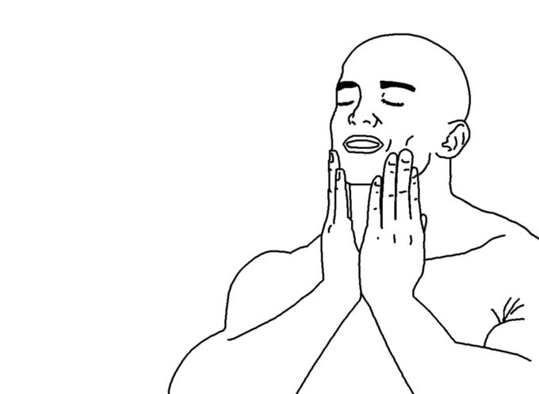

</div>

---

## What this workshop offers

I am kind of a perfectionist and like to customize everything.

What I will share with you is the result of 10 years of perfecting my setup.

The focus will be:

- A highly opinionated way of using macOS,
- Removing barriers to productivity,
- Having a neat, customized OS and tools.

---

## You don't have to take everything

I'm just showing you my way of working:

- Keep what you like
- Knowing about the rest will still help

---

## Practice makes perfect

This workshop will:

- What to avoid.
- Teach a lot of keyboard shortcuts.

**It will take some time to stick, come back to these slides.**

(And don't hesitate to contact me to ask questions!)

---

## My history with computers

---

## Phase 1

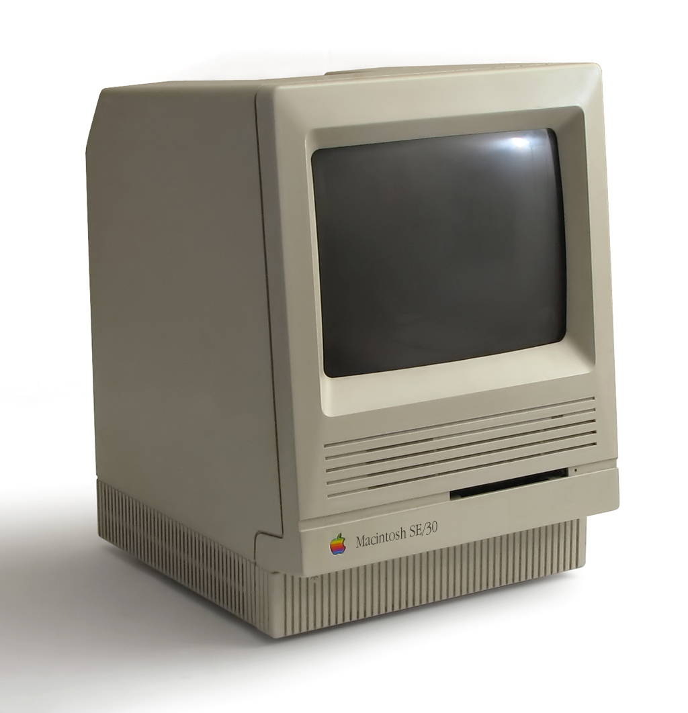

- Started using a Mac at age 3-4
- Macintosh SE/30
- 1 MB of RAM (extended to 2 MB)
- 512 × 342 black and white
- Classic Mac OS:
    not suited at all for developers

---

## Phase 2

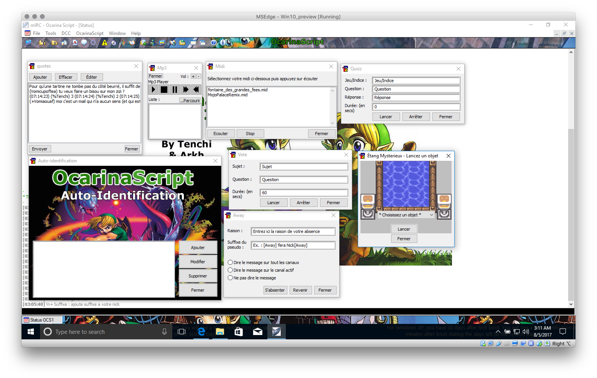
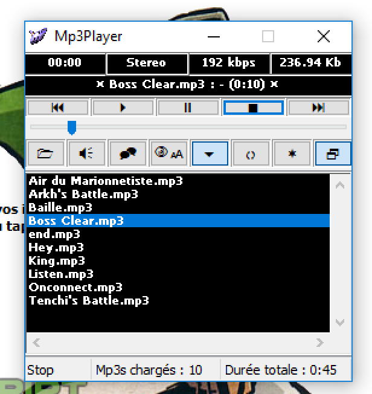

- Switched to windows at around age 10
- Age 11: made my own mIRC script client with ~100 users
- First Python project at age 12: Pong clone
- Random explorations of Linux many times
    - Windows is OK for dev. Experience is unstable
    - Linux is great for dev but needs a lot of care and troubleshooting

---

## Phase 3

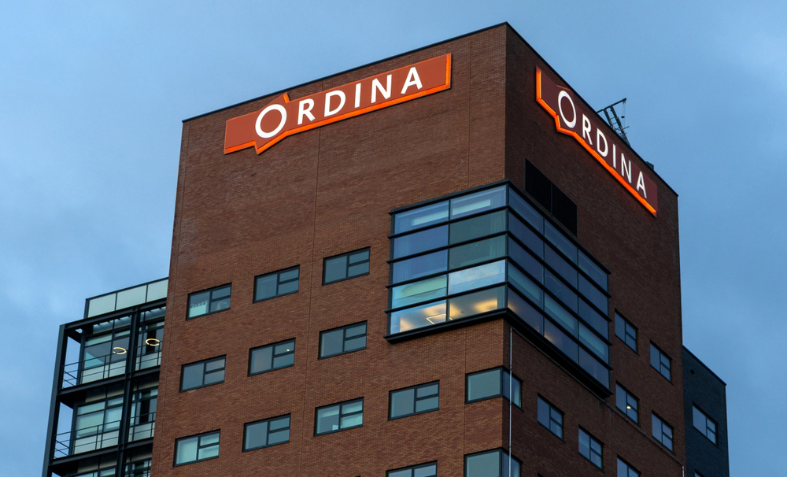

- 2015: Started at Ordina's *“Scala Team”*
- Only team at Ordina with Macbooks
- Mac OS X was based on Free BSD
- With some tweaks and getting used to:
    - UNIX-like experience and easy to use
    - Great for dev! The ups of Windows and Linux without their downs.

---

<!-- _header: '' -->
<!-- _footer: '' -->

# II. OS navigation

*It's not what it looks like! I can explain!*

---

## MacOS Usage overview

- Two main modes of usage:

    1. Casual: full screen apps, multiple spaces, gestures.
    2. Power user: all in one screen, keyboard shortcuts (almost no gestures).

- Many features aimed at casual use can make things *frustrating*:
    This gives macOS a casual reputation.

→ We're going to curate features and learn some power tools.

---

## Basic window management

- Traffic light buttons: 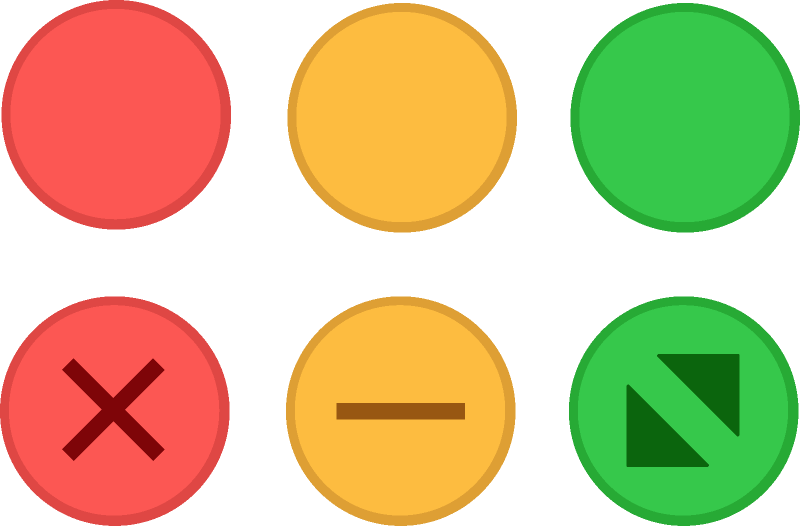
    - <span style="color: red">**Red**</span>: close,
        **Note**: Closing the last window of an app most often doesn't quit the app.
    - <span style="color: #fb0">**Yellow**</span>: minimize,
        **Recommendation**: never use, forget about minimizing.
    - <span style="color: green">**Green**</span>: full screen.
        **Recommendation**: use rarely, remember that it makes a new space.
- Double click title bar: maximize (we'll come back on this later).
- Exposé: overview of *all windows* or *current application*.

---

## A note about closing windows

- On Windows, closing an app's main window exits that app.
- On macOS, the app keeps running:
    - Focusing that app shows no window, but the menu bar has its name and menu items.
    - This results in a lot of zombie apps that take ram and do nothing.
    - Only by quitting the app with <kbd>⌘</kbd> + <kbd>Q</kbd> or using the menu actually quits the app.

Don't close windows, just use <kbd>⌘</kbd> + <kbd>Q</kbd>.

---

## A note about minimization

- On Windows, minimizing a window just hides it.
- On macOS, minimizing a window puts it in a special prison cell:
    - It disappears from alt-tab,
    - It disappears from Exposé,
    - It literally goes to prison, in the tiny tiny dock.

Don't minimize windows, they will be sad, and you too.

---

## Spaces

- Each space has its own windows.
    - Alt tabbing between apps that are in multiple spaces can be confusing.
- Each full screen *window* is in its own space (even a full screen YouTube video).
- Exposé part 2: move windows to other spaces.

**Recommendation**: never use spaces, unless you need one app in full screen (for a presentation).

---

## A note about full screen

- On Windows, clicking the “maximize” icon (here the green ball 🟢) just makes the window use as much space as possible on the screen.
- On macOS, it puts the application in full screen. Full screen apps go to their own dedicated space:
    - It disappears from alt-tab,
    - It disappears from that app's Exposé (but goes to the top of the Exposé screen).

Don't full screen windows, unless you want to look neater during a presentation.

---

## A note about the traffic light buttons 

**Recommendation**: avoid using.

---

## Spotlight

One of the most useful shortcuts: <kbd>⌘</kbd> + <kbd>Space</kbd>.

Use it for everything:
- Launching apps (launching same app switches focus to it),
- Searching files,
- Quick web search.

**Recommendation**: use it all the time.

---

## The desktop

**Recommendation**: never use.

---

## The dock

- Basically just a list of app shortcuts.
- Not like the Windows taskbar, each icon is one application, not window.
- “Minimized” windows go down there on the right: this is not useful at all, avoid minimizing.

**Recommendations**:

- Can be used for quick app shortcuts, but just use Spotlight instead.
- Keep it hidden for maximal screen real estate.

---

## Finder

The “Explorer” of macOS. It's better because you don't explore, you find.

Worthy of note:

- You can't exit that the Finder. It runs forever and <kbd>⌘</kbd> + <kbd>Q</kbd> does nothing.
- Supports tabs (<kbd>⌘</kbd> + <kbd>T</kbd>).
- Dragging files moves, hold <kbd>⌥</kbd> to copy.
- Use <kbd>Space</kbd> to preview things (more on that on the *Preview* slide).

---

<!-- _header: '' -->
<!-- _footer: '' -->

# III. Keyboard shortcuts

*A frankly unreasonable amount of shortcuts.*

---

## Why keyboard shortcuts

Our focus today:
- Navigating the OS without clicking around,
- Editing text efficiently,
- Being in control and overall productivity.

It will feel like a lot, but I didn't look up any of these: it's really the list of stuff I use daily.

**Note**: The following slides apply OS-wide.

---

## The cast of characters

In order of awesomeness (subjective).

---

### Command

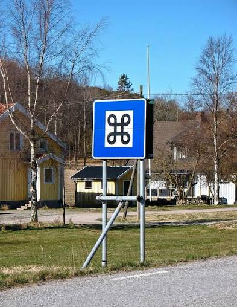

Symbolized as <kbd>⌘</kbd>

<small>

Most main actions (or *commands* see what they did there) of an app use <kbd>⌘</kbd> (and not the *Control* key like in Windows).

**Fun facts**:
- Chosen by Susan Kare, designer of the icons in classic Mac OS and the Solitaire cards in Windows 3.1.
- In Scandinavia: denotes a place of cultural interest.

</small>

---

### Control


Symbolized as <kbd>⌃</kbd>

<small>

Macs have both *Command* and *Control*,<br>and it makes them keyboard-shortcut monsters.
- Windows and Linux barely use their *Meta* key, and its usage is for global shortcuts.
- On Mac, *Command* is completely application-oriented, tripling keyboard shortcuts:
    - <kbd>⌘</kbd> + <kbd>…</kbd>
    - <kbd>⌃</kbd> + <kbd>…</kbd>
    - <kbd>⌃</kbd> + <kbd>⌘</kbd> + <kbd>…</kbd>

**Fun fact**: the ⌃ is used on road signs to indicate roofed infrastructure.

</small>

---


### Option

Symbolized as <kbd>⌥</kbd>

*Option* is the macOS name for *Alt*:
- Used less for keyboard combinations (but still used).
- <kbd>⌥</kbd> + any letter makes symbols.
- Rarely used for shortcut combos.

**Fun fact**: I'm *really* struggling to keep the road sign theme going on.

---

<div class="columns">
<div>

### Fn

Symbolized as <kbd>Fn</kbd>

<small>

- Simulate missing keys (Page up, home, F-keys, etc.).
- Switch keyboard layouts.

**Note**:
- On Windows laptops, <kbd>Fn</kbd> is just a hardware-level key to compensate for missing keys.
- On macOS, <kbd>Fn</kbd> is actually handled at the OS-level and is used in some keyboard shortcuts.

</small>

</div><div>


<center><small>

*Yep I give up, best I could find.*<br>**Fun fact**: *It's a weapons factory in Belgium.*

</small></center>

</div></div>

---

## The shortcuts

In order of whatever (subjective).

---

### Keyboard window management

|Shortcut|Action|
|:-------|:-----|
<kbd>⌘</kbd> + <kbd>Tab</kbd>|Tabbing through **applications** (<kbd>⇧</kbd>: reverse).
<kbd>⌘</kbd> + <kbd><</kbd> / <kbd>></kbd>|Tabbing through **windows**.
<kbd>⌘</kbd> + <kbd>W</kbd>|Close window.
<kbd>⌘</kbd> + <kbd>⇧</kbd> + <kbd>W</kbd>|Close all windows in current app.
<kbd>⌘</kbd> + <kbd>Q</kbd>|Quit application. Recommended: disable in some important apps.
<kbd>⌃</kbd> + <kbd>⌘</kbd> + <kbd>F</kbd>|Toggle full screen (same as green button).

---

### Clipboard

- Keyboard: <kbd>⌘</kbd> + <kbd>X</kbd> / <kbd>C</kbd> / <kbd>V</kbd>: Cut / Copy / Paste.

    **Note**: since copying is bound to ⌘, this means that <kbd>⌃</kbd> + <kbd>C</kbd> is still available!

- Terminal: `pbcopy` and `pbpaste` commands, very useful:

    ```bash
    cat slide.md | pbcopy  # copies the contents of slide.md into clipboard
    pbpaste > new_slides.md  # pastes the contents of the clipboard into new file
    echo "Hello, $(pbpaste), bye bye" > wrapped_slides.md  # Can be used like any command
    ```

---

### Classic UNIX keyboard shortcuts

MacOS inherits some UNIX terminal keyboard shortcuts **OS-wide**.

That's right, not just in terminals, but **everywhere you can type text**.

|Shortcut|Action|
|:-------|:-----|
<kbd>⌃</kbd> + <kbd>A</kbd> / <kbd>E</kbd>|Jump to beginning/end of line.
<kbd>⌃</kbd> + <kbd>T</kbd>|Transpose letters.
<kbd>⌃</kbd> + <kbd>B</kbd> / <kbd>F</kbd>|Move one character left/right.

---

### Moving around text

|Shortcut|Action|
|:-------|:-----|
<kbd>Fn</kbd> + <kbd>↑</kbd> / <kbd>↓</kbd>|Page up/down.
<kbd>Fn</kbd> + <kbd>←</kbd> / <kbd>→</kbd>|Home/end.
<kbd>Fn</kbd> + <kbd>⌫</kbd>|Erase to the right (like <kbd>Del</kbd>).
<kbd>⌥</kbd> + <kbd>←</kbd> / <kbd>→</kbd>|Move cursor a whole word left/right. Combine with <kbd>⇧</kbd> for selection.
<kbd>⌘</kbd> + <kbd>←</kbd> / <kbd>→</kbd>|Move to beginning/end of physical. line<br>(behavior slightly different than <kbd>⌃</kbd> + <kbd>A</kbd> / <kbd>E</kbd>).

---

### Searching

|Shortcut|Action|
|:-------|:-----|
<kbd>⌘</kbd> + <kbd>F</kbd>|Start search.
<kbd>⌘</kbd> + <kbd>G</kbd>|Next result.
<kbd>⌘</kbd> + <kbd>⇧</kbd> + <kbd>G</kbd>|Previous result.

**Note**: Shift ⇧ often inverses the effect of a shortcut (or expands its scope, like "Close all windows").

---

### Screenshots

Prepare for some carpal tunnel syndrome:

|Shortcut|Action|
|:-------|:-----|
<kbd>⌘</kbd> + <kbd>⇧</kbd> + <kbd>3</kbd>|Capture whole screen, save to configured folder.
<kbd>⌃</kbd> + <kbd>⌘</kbd> + <kbd>⇧</kbd> + <kbd>3</kbd>|Capture whole screen, save to clipboard.
<kbd>⌘</kbd> + <kbd>⇧</kbd> + <kbd>4</kbd>|Capture selection (drag mouse), save to configured folder.
<kbd>⌃</kbd> + <kbd>⌘</kbd> + <kbd>⇧</kbd> + <kbd>4</kbd>|Capture selection (drag mouse), save to clipboard.
<kbd>⌘</kbd> + <kbd>⇧</kbd> + <kbd>5</kbd>|Screen recording tool.
<kbd>⌃</kbd> + <kbd>⌘</kbd> + <kbd>Esc</kbd>|Stop recording.

---

<div class="columns">
<div>

### Capture selection to clipboard

<small>

You're probably thinking: *“WTF.”*

1. First place your thumb on <kbd>⌘</kbd>,
2. Then place your pinky on <kbd>⇧</kbd>,
3. Then place your ring finger on <kbd>⌃</kbd>,
4. Finally, flatten your hand and reach for <kbd>4</kbd>
    with your index finger.
5. You can now release the keys!
6. Drag a box with your mouse and release.

**Pro tip**: while dragging the box, keep holding mouse click and hold <kbd>Space</kbd> to reposition the box.

</small>

</div>
<div>

<center>

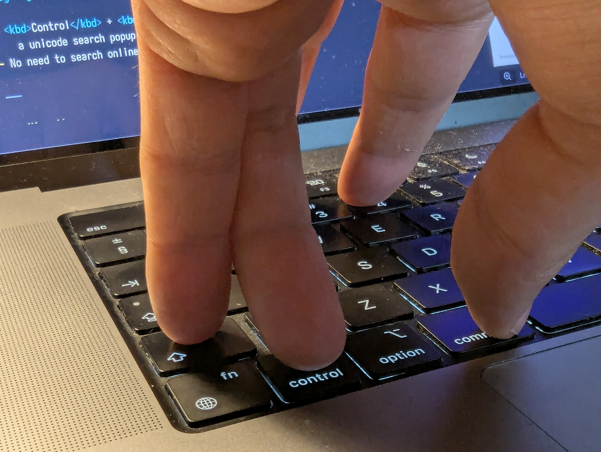 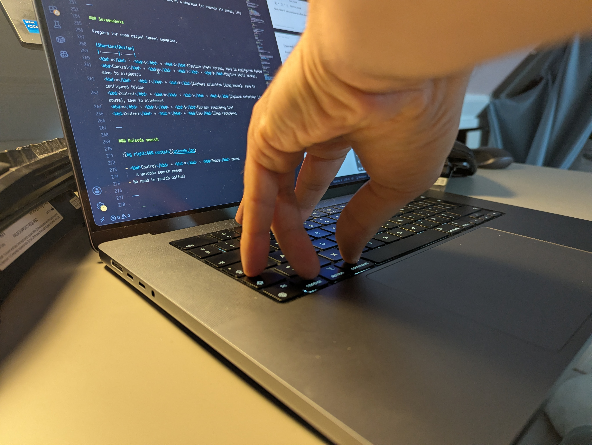

Figure 38.a and 38.b: How to RSI

</center>

</div></div>

---

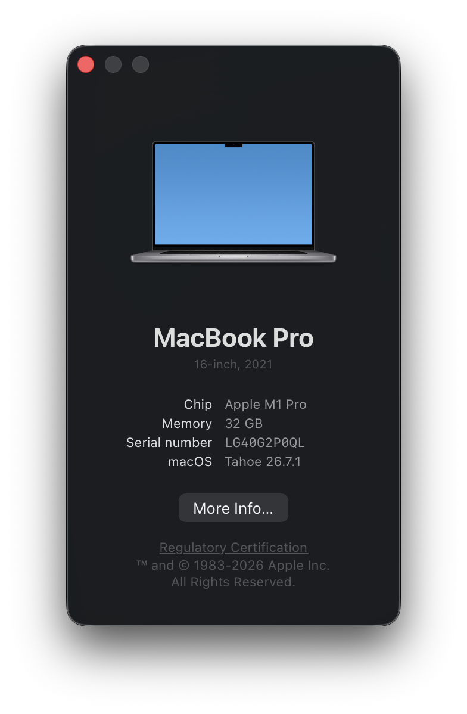

### Window mode

In mode 4 (drag a box thingy), press <kbd>Space</kbd> to switch to window capture mode.

- Captures a single window,
- With PNG transparency and shadows,
- Isolated from anything in the background.

---

### Unicode search

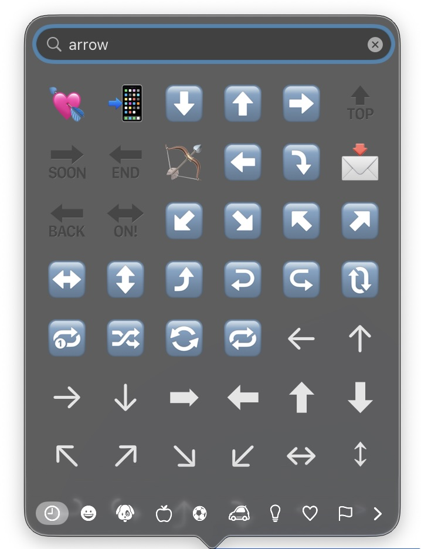

- <kbd>⌃</kbd> + <kbd>⌘</kbd> + <kbd>Space</kbd> opens
    a Unicode search popup.
- No need to search online!

---

## Miscellaneous

- Long hold a vowel to open a popup with accented variants.
- <kbd>⌥</kbd> + any letter makes symbols.
- <kbd>⇧</kbd> + <kbd>⌥</kbd> + any letter makes even more symbols.
    - For example, to make “Pretty quotes”: (<kbd>⇧</kbd> +) <kbd>⌥</kbd> + <kbd>[</kbd>
- Application settings standard shortcut is <kbd>⌘</kbd> + <kbd>,</kbd>
    - If you try <kbd>⌘</kbd> + <kbd>P</kbd> like on Windows, that's the *Print* command instead.
- <kbd>⌥</kbd> + <kbd>⌘</kbd> + <kbd>D</kbd>: toggle dock auto-hide.

---

## Gestures

<small>

|Gesture|Action|
|:-------|:-----|
|Three fingers up|Show all windows across all apps (and spaces).
|Three fingers down|Show all windows in current app.
|Swipe three fingers to the left/right|Switch spaces (or switch to full screen app).
|Place four fingers down then spread them|Show desktop (🤮).
|Drag two fingers in any direction in a scrollable area|Scroll (direction depends on “natural direction” setting).
|Drag two fingers to the left/right|Navigate to previous/next page (in a browser).
|Drag two fingers from the right, outside of the trackpad|Show notifications.

</small>

---

# IV. Pitfalls

*Tiny chapter to make it a nice three-column table of contents.*

---

<small>

## Common issues

If you can't find your app:

- You might have minimized it with <kbd>⌘</kbd> + <kbd>M</kbd> or the 🟡 button.
    Look at your dock in the bottom right area.
- You might have full screened it with <kbd>⌃</kbd> + <kbd>⌘</kbd> + <kbd>F</kbd> or the 🟢 button.
    Look at your spaces by swiping three fingers around.

You have a lot of apps running for no reason. Tabbing to them shows nothing:

- You closed all the windows of that app using <kbd>⌘</kbd> + <kbd>W</kbd> or the 🔴 button.
    Closing windows does not quit apps.
    Quit the app with <kbd>⌘</kbd> + <kbd>Q</kbd> or click the main menu of that app (just right of the Apple logo) and choose “Quit”

</small>

---

## Advice

- Don't minimize, and only full-screen for videos or presentations.
- Keep all your windows in one space. To find your windows, do either:
    - A combination of <kbd>⌘</kbd> + <kbd>Tab</kbd> and <kbd>⌘</kbd> + <kbd><</kbd> / <kbd>></kbd>.
    - A combination of <kbd>⌘</kbd> + <kbd>Tab</kbd> and the three fingers down gesture.
    - Three fingers up gesture (if you have a very recognizable window).
- When you intend to quit an app, don't use the 🔴 button. Quit the app instead.

---

<!-- _header: '' -->
<!-- _footer: '' -->

# V. Third-party tools and applications

*The rest of the batteries.*

---

## Preamble

Everything after these slides will be automatically installed during the last chapter.

These slides are for demos, and later for reference.

---

### Homebrew

<small>

|||
|:---|:---|
|**Description**|De facto standard package manager for macOS, maintained by the community.
|**Model**|FOSS
|**Link**|https://brew.sh
|**Install**|`/bin/bash -c "$(curl -fsSL https://raw.githubusercontent.com/Homebrew/install/HEAD/install.sh)"`|

**Notes**:

- Main function: install packages and dependencies
- Secondary function: install GUI applications (called “casks”)

</small>

---

### iTerm2

<small>
<div class="columns">

<div>

|||
|:---|:---|
|**Description**|<small>`Terminal.app` sucks. Use this instead.</small>
|**Model**|FOSS
|**Link**|https://iterm2.com
|**Install**|`brew install --cask iterm2`|

**Good alternatives**:

- [Ghostty](https://ghostty.org)
- [kitty](https://sw.kovidgoyal.net/kitty)
- [Alacritty](https://alacritty.org)

</div><div>

- Best feature: global hotkey. I set it to <kbd>⌘</kbd> + <kbd>§</kbd>.
- Second best-feature: automatic copying.

Useful shortcuts:
- <kbd>⌘</kbd> + <kbd>T</kbd>: New tab.
- <kbd>⌘</kbd> + <kbd>K</kbd>: Clear.
- <kbd>⌘</kbd> + <kbd>D</kbd>: Split vertical.
- <kbd>⌘</kbd> + <kbd>⇧</kbd> + <kbd>D</kbd>: Split horizontal.
- <kbd>⌃</kbd> + <kbd>D</kbd>: Close tab/panel (standard UNIX for logging out).

</div></div>
</small>

---

### Sublime Text

<small>
<div class="columns">

<div>

|||
|:---|:---|
|**Description**|Lean, fast and customizable text editor.
|**Model**|Paid, with eternal free trial
|**Link**|https://www.sublimetext.com
|**Install**|<small><small>`brew install --cask sublime-text`</small></small>|

**Good alternatives**:
- [neovim](https://neovim.io/) for vim people.
- [Zed](https://zed.dev/)

*Built-in TextEdit app not recommended.*

</div><div>

- Not a replacement to IDEs, just a good text editor.
- Nice as a default for opening text-based files.
- Many plugins and themes.
- Very easy to hack via Python.
- Opens instantly.
- Persists all windows and tabs.
- Very good multi-line editing (invented the concept!).

</div></div>
</small>

---

<!-- _header: '' -->
<!-- _footer: '' -->

# VI. Third-party extensions

*Unofficial tools to customize the OS more, or add missing functionalities.*

<!-- In its pursuit of casuals and simplicity, there's a lot of features and customization missing from macOS.

The good news is that a lot of third party apps fix that for us.

A lot of them used to be paid, but now there's a plethora of free or FOSS alternatives. -->

---

### Rectangle

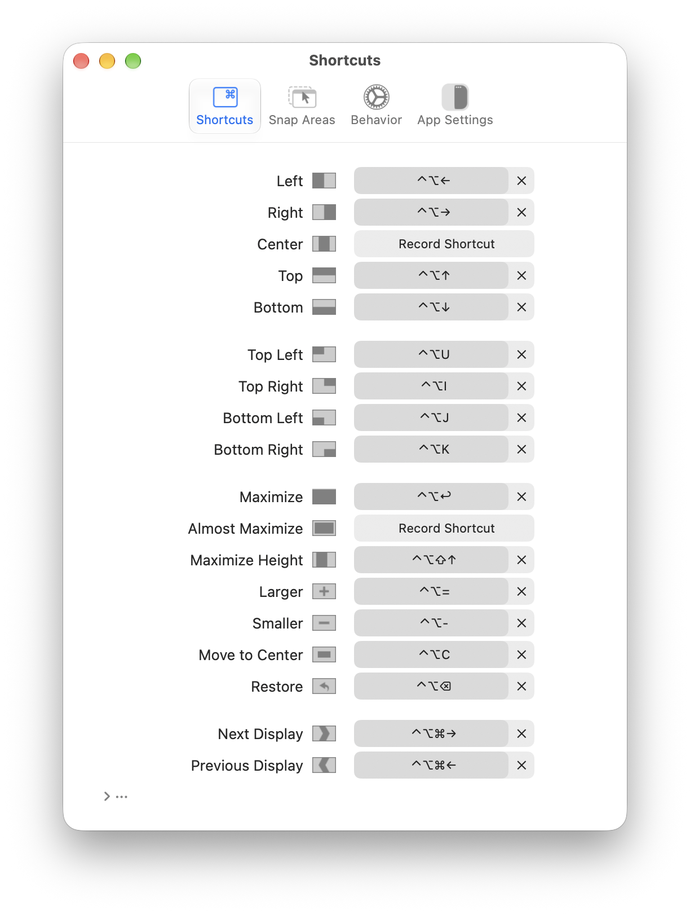

<small>

|||
|:---|:---|
|**Description**|Window management app
|**Model**|FOSS
|**Link**|https://github.com/rxhanson/Rectangle
|**Install**|`brew install --cask rectangle`|

**Notes**:
- MacOS has its own shortcuts, but the animations are long, and the shortcuts not customizable or natural.
- My favorite shortcut prefix for this app is <kbd>⌥</kbd> + <kbd>⌘</kbd>.
- I said we'll come back to it later: to maximize, I don't double click a title bar, I do <kbd>⌥</kbd> + <kbd>⌘</kbd> + <kbd>F</kbd>.

</small>

---

### Hidden Bar

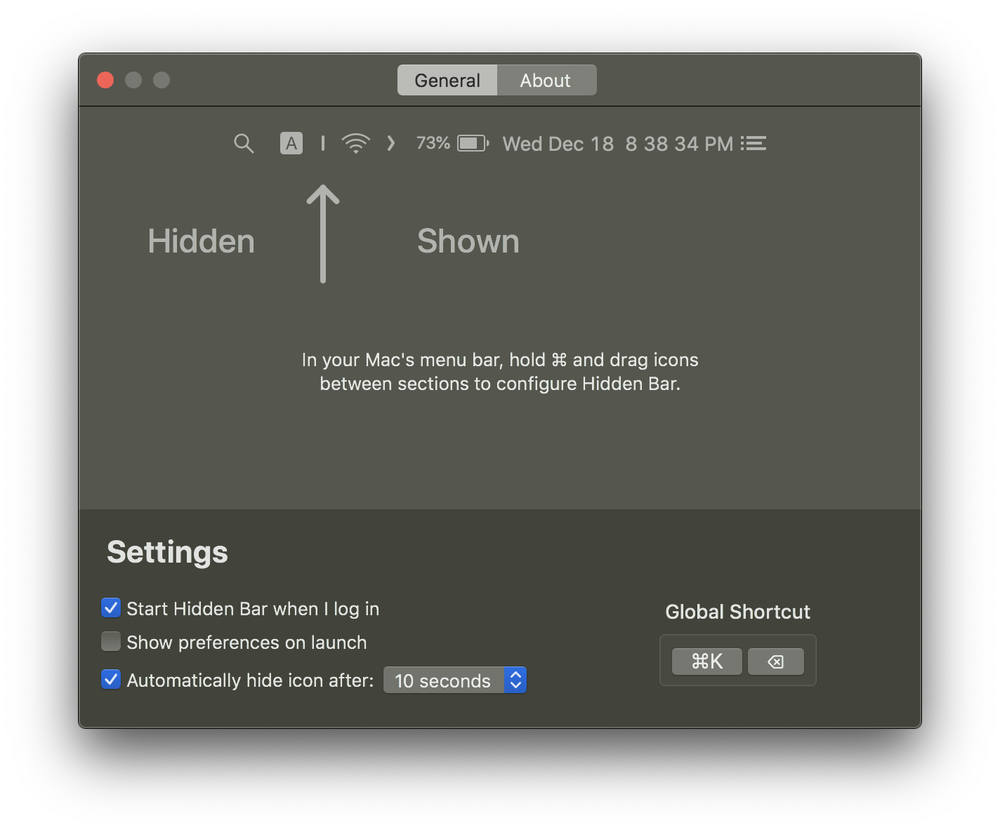

<small>

|||
|:---|:---|
|**Description**|Hides your excess menu bar icons
|**Model**|FOSS
|**Link**|https://github.com/dwarvesf/hidden
|**Install**|`brew install --cask hiddenbar`|

**Notes**:
- Can't believe this is not in standard macOS.
- Click the arrow to expand.
- Right click the arrow to show super-hidden icons.

</small>

---

### Keeping You Awake

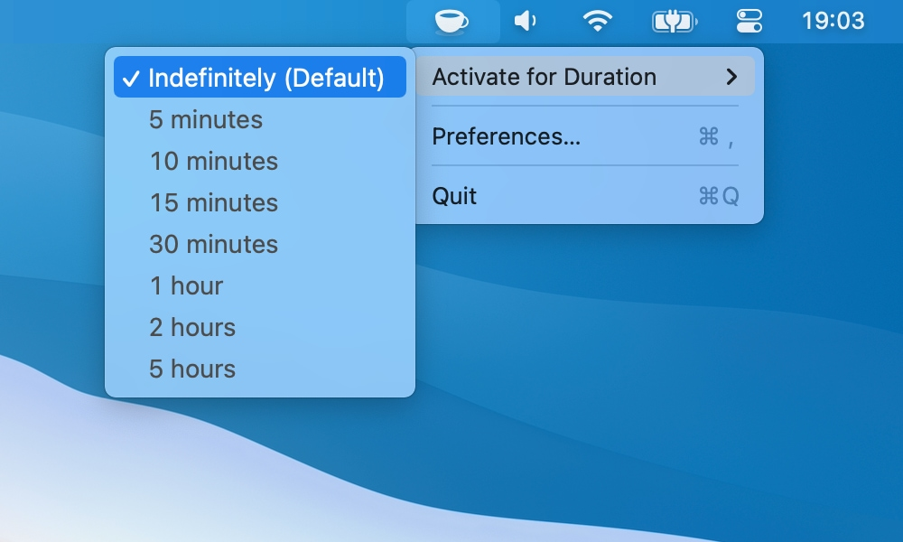

<small>

|||
|:---|:---|
|**Description**|Prevents your Macbook from sleeping
|**Model**|FOSS
|**Link**|https://github.com/newmarcel/KeepingYouAwake
|**Install**|`brew install --cask keepingyouawake`|

**Notes**:
- Quick toggle for letting your Mac sleep on idle or not.

</small>

---

### Linear Mouse

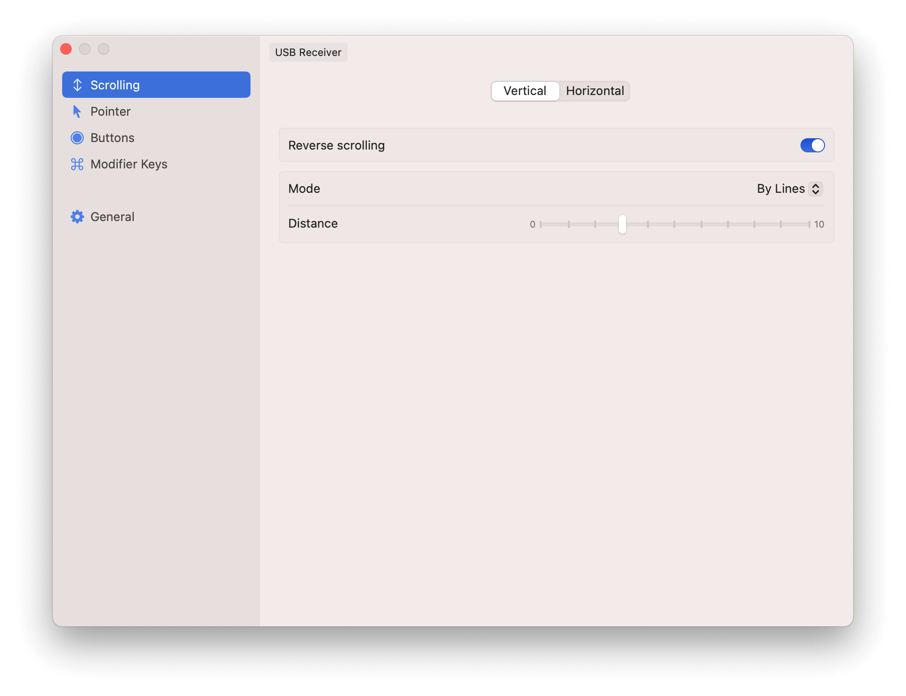

<small>

|||
|:---|:---|
|**Description**|Disables acceleration on physical scroll wheels
|**Model**|FOSS
|**Link**|https://github.com/linearmouse/linearmouse
|**Install**|`brew install --cask linearmouse`|

**Notes**:
- On macOS, the faster you scroll, the more it scrolls.
    If you scroll just one tick, it will literally move one pixel.
- With this app:
    One mousewheel tick = a fixed number of lines.

</small>

---

### Top Notch

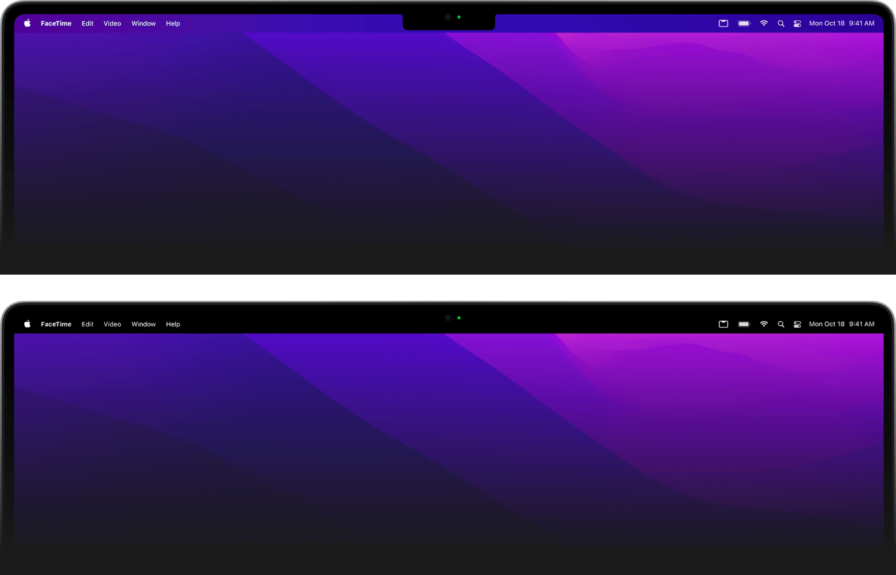

<small>

|||
|:---|:---|
|**Description**|Hides the stupid notch
|**Model**|Free, but not open source
|**Link**|https://topnotch.app
|**Install**|`brew install --cask topnotch`|

**Notes**:
- To make laptops uslessly sexier, Apple reduced the bezel by adding a thick ugly notch.
- This modifies your wallpaper and adds a black bar.
- Not only you can't see the notch, but it actually looks cooler.
- Sometimes it forgets to do it, just click the menu bar icon.

</small>

---

### SwitchResX

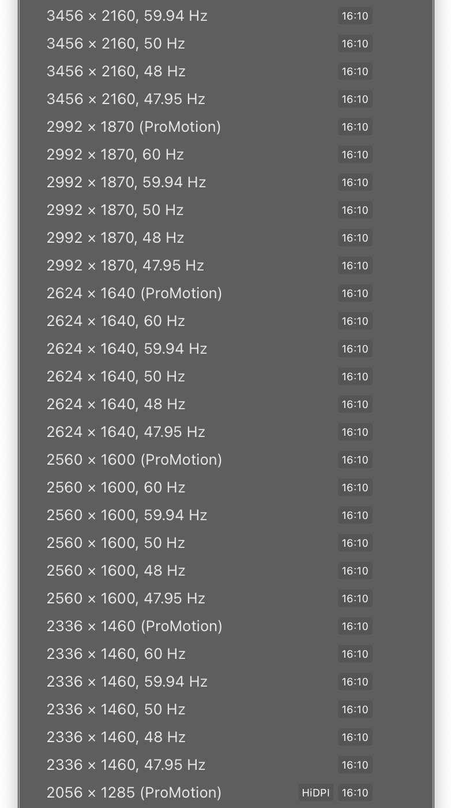

<small>

|||
|:---|:---|
|**Description**|Switch any monitor to any resolution
|**Model**|Paid: 14€ lifetime license
|**Link**|https://www.madrau.com
|**Install**|`brew install --cask switchresx`|

**Notes**:
- Apple thinks resolutions are scary for casuals, so they just give DPI scaling options.
- With this you can control exactly what resolution, scaling and refresh rate for anything plugged into your Mac.
- Very useful for presentations.

</small>

---

<!-- _header: '' -->
<!-- _footer: '' -->

# VII. Useful built-in applications

*Comes with some batteries included.*

---

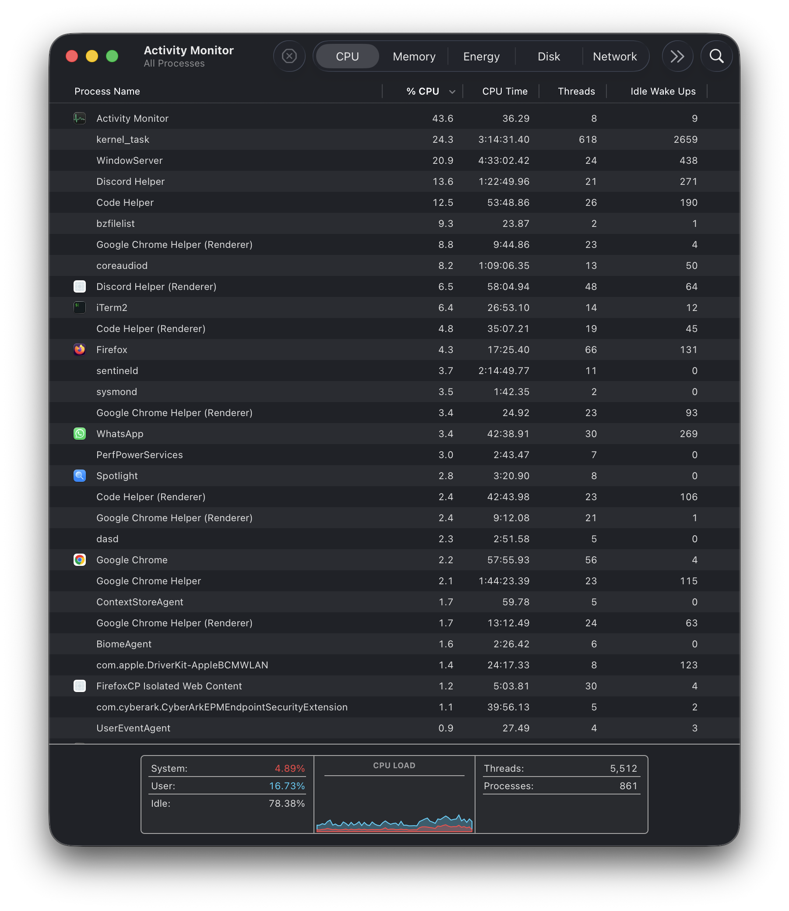

## Activity monitor

Just like the task manager on Windows, with more options.

---

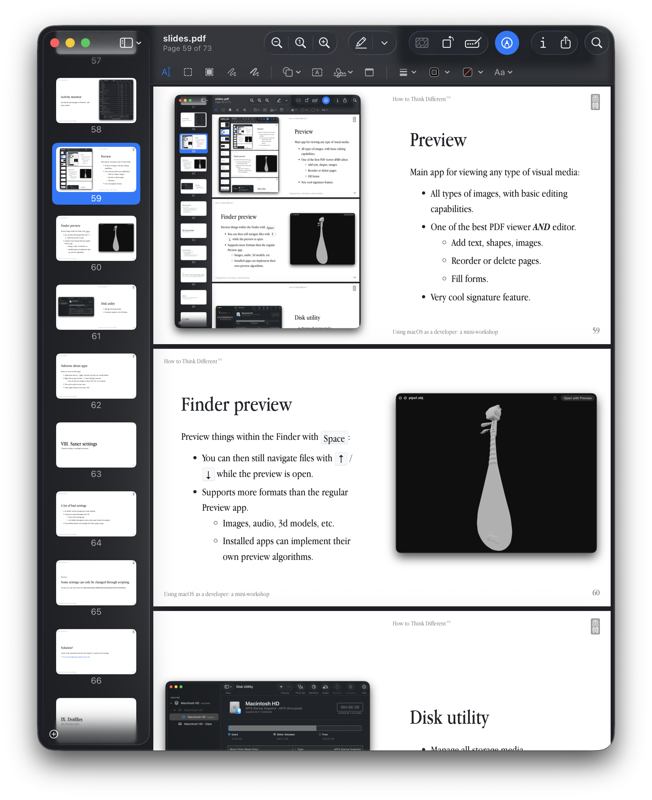

## Preview

Main app for viewing any type of visual media:

- All types of images, with basic editing capabilities.
- One of the best PDF viewer ***AND*** editor.
    - Add text, shapes, images.
    - Reorder or delete pages.
    - Fill forms.
- Very cool signature feature.

---

## Finder preview

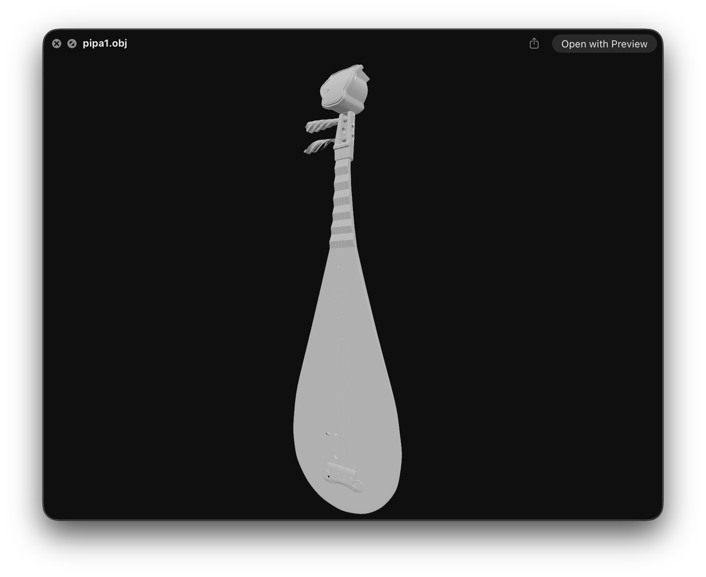

Preview things within the Finder with <kbd>Space</kbd>:

- You can then still navigate files with <kbd>↑</kbd> / <kbd>↓</kbd> while the preview is open.
- Supports more formats than the regular Preview app.
    - Images, audio, 3d models, etc.
    - Installed apps can implement their own preview algorithms.

---

## Disk utility

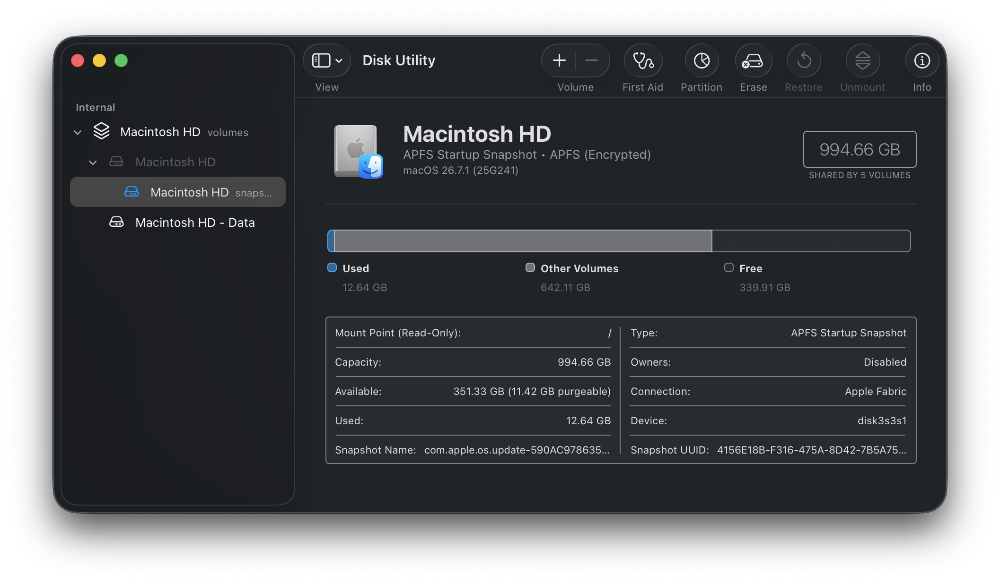

- Manage all storage media.
- Formatter supports a lot of formats.

---

## Sidenote about apps

Before we move on from apps:

- Applications have an `.app` extension, but they are actually folders.
- Right click an app in Finder → “Show Package Contents”.
    - You can also just navigate to them with `ls` in a terminal.
- This can be useful in some cases.
- Other Apple formats do the same trick.

---

<!-- _header: '' -->
<!-- _footer: '' -->

# VIII. Saner settings

*“Natural scrolling” is nothing but natural.*

---

## A lot of bad settings

- By default, various settings have insane defaults.
- Settings are spread throughout the OS:
    - Some in the Settings app
    - A lot hidden throughout various other apps (Finder for example)
- You probably already went through all of those page by page.

---

*However...*

## Some settings can only be changed through scripting.

<small>

And they have super funky names like `NSGlobalDomain.NSNavPanelExpandedStateForSaveMode2`

</small>

---

## Solution?

As part of the automation from the next chapter, I curated a list of settings.

→ [Let's go through them quickly just for fun.](https://github.com/Tenchi2xh/dotfiles/blob/main/config/macos-preferences.yaml)

---

<!-- _header: '' -->
<!-- _footer: '' -->

# IX. Dotfiles

*Hide yo files, hide yo folders.*

---

## What are dotfiles?

- On UNIX-like environments, hidden files or folders.
- Most tools will pollute your `~/` full of dotfiles.
- Configuring a whole new computer can take a week.
    - People have started version controlling their home folder dotfiles.
    - Even better: they made tools to manage and apply their version-controlled dotfiles.
    - It's like CI for your own computer.

---

## Chezmoi

- Tool for applying dotfiles easily.
- Every file/script is templatable.
- Supports various triggers for executing scripts.
- Support for many password managers.
- Explicit name-based permissions: private files, executables, etc.
- Dotfiles made by Chezmoi are symlinks
    → **Change your settings in an app, the change is made directly in your repository**.
- And many other features I don't use.

---

## My dotfiles

<small>

- All my configs, settings, custom scripts, in one repo: https://github.com/Tenchi2xh/dotfiles
- What it does:
    - Installs apps, extensions and CLI tools,
    - Setup custom file associations,
    - Configure macOS with custom settings,
    - Configure `zsh` with custom theme, animations and plugins,
    - Configure some third-party tools,
    - Installs and uses my own customized terminal font,
    - Optional: organize the dock and set up custom icons.
- Very opinionated and themed around my branding, but easily customizable.

</small>

---

## Requirements

<small>

- Install Homebrew:
    ```bash
    /bin/bash -c "$(curl -fsSL https://raw.githubusercontent.com/Homebrew/install/HEAD/install.sh)"
    ```
- Install Chezmoi: `brew install chezmoi`.
- If using Bitwarden: `brew install bitwarden-cli`.
- Create a `SSH Key` entry in bitwarden, add your private SSH key in the notes field.
    → If not desired, delete `dotfiles/private_dot_ssh/private_id_rsa.tmpl`
- Create an `Auth tokens` entry in bitwarden, add a custom field `HOMEBREW_GITHUB_API_TOKEN`.
    → If not desired, delete the line `export HOMEBREW_GITHUB_API_TOKEN=...` in `dotfiles/dotfiles/dot_zprofile.tmpl`.

</small>

---

## How to use them

<small>

- Fork my repo https://github.com/Tenchi2xh/dotfiles.
- Leave a ★.
- In the `config/` folder, remove or edit what you don't need from the YAMLs (leave empty lists when needed).
- In the `scripts/` folder, remove scripts you don't care about (for example Dock customization, custom icons).
- In the `dotfiles/` folder, remove config files that don't apply to you (also replace the public SSH key).
- `commit` and `push`.
- If using Bitwarden: `bw login` and `bw unlock`.
- Apply: `chezmoi init --apply [YOUR_GITHUB_USERNAME]`

</small>

---

<center>


# Peace.

</center>